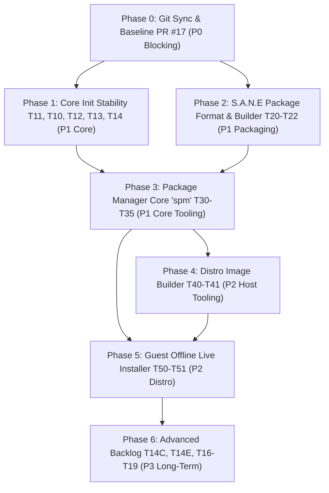

# S.A.N.E Linux — Comprehensive Engineering Roadmap & TODOS

**Repository:** `sane-linux` (PID 1 Init Daemon `ninit`, Minimal Appliance, Package Manager `spm`, Limine Bootloader & Live Installer)  
**Lead Coordinator (Mayor):** Lead (Session 1)  
**Planners:** Planner 1 (Session 19) & Planner 2 (Session 20 — NVIDIA Nemotron-3-Ultra)  
**Reviewer & Auditor:** Session 0 (Qoder) & Session 21 / Session 6 (Auditor)  
**Implementors:** Session 5 (Worker 1 — System Coder) & Session 6 (Worker 2 — Test Harness Coder)  
**Status:** ACTIVE SPECIFICATION & ROADMAP — Updated Post-Session 19/20 Architecture Consensus

---

## 0. Operating Directives & Engineering Standards

### 0.1 Ground Rules & File Immutability
- **Immutable Files:** `/home/ubuntu/soul.md` and `/home/ubuntu/memory.md` are strictly locked. Never modify, patch, or overwrite them.
- **Git Commit Authority:** Exclusively held by Lead (Session 1).
  - Git Author: `Rzy <168882072+Iky969@users.noreply.github.com>`
  - Commits MUST follow Conventional Commits format (`feat(...)`, `fix(...)`, `docs(...)`, `test(...)`, `refactor(...)`).
- **Gating Gate & Verification Protocol:** No ticket can be checked off `[✓]` without raw execution proof attached in PR/audit documentation:
  1. Build compilation: `gcc -static -O2 -Wall -Werror` zero warnings.
  2. Linter compliance: `make lint` exit code 0 (no forbidden English/Indonesian violations).
  3. Regression test suite: `sudo make test` 100% PASS across all suites.
  4. Isolation integrity: Host cgroups must be completely cleaned up (`ls -d /sys/fs/cgroup/ninit*` returns empty / exit code 2).

### 0.2 Architecture Tenets
1. **Zero-Bloat & Minimal RAM Footprint:** Distro target is <30 MB total RAM, static binaries, zero dynamic linker overhead.
2. **Fail-Closed Semantics:** On missing dependency, checksum mismatch, path traversal attempt, or corrupted state, abort cleanly without partial mutations.
3. **No Blind Escalation / Anti `rm -rf`:** Directory removal is strictly bottom-up (`rmdir` empty directories only).
4. **Offline-First:** No reliance on network fetches during package installation or system installation from live media.

---

## 1. Roadmap Phase Breakdown & Priority Sequence



---

## Phase 0: Git Synchronization & Baseline Locking [P0 - Blocking]

- [x] **T0-SYNC: PR #17 Synchronization from `feat/cgroup-handshake-multitier` to `main`**
  - **Component:** Repository / Git Infrastructure
  - **Owner:** Lead (Session 1)
  - **Status:** COMPLETED (PR #17 merged into `main` at `7ccf49f`, all 4 CI checks PASS, tag `v1.1.0` unified)
  - **Target Files:** Remote `origin/main`, branch `feat/cgroup-handshake-multitier`
  - **Objective:** Synchronize the 7 Phase 0b commits (`01a2b49` through `4e9d3b8`, tag `v1.1.0`) currently living on `feat/cgroup-handshake-multitier` into `main`. Ensure local `main` matches `origin/main`.
  - **Acceptance Criteria:**
    - `origin/main` HEAD points to `4e9d3b8` (or clean merge commit).
    - `git describe --tags` on `main` outputs `v1.1.0`.
    - `sane-linux-test` and `sane-linux` are fully in sync with `origin/main`.
  - **Verification Commands:**
    ```bash
    git fetch origin
    git log --oneline origin/main -n 5
    git describe --tags origin/main
    ```

---

## Phase 1: Core Init Daemon Hardening & Stability [P1 - Core Init]

- [x] **T11: Child Spawn Failure Propagation & Defensive EAGAIN Retry** (COMPLETED: PR #18 @ 47857f4)
  - **Component:** `ninit.c` (Process Lifecycle)
  - **Owner:** Coder 1 (Session 25) | Audit: Session 24
  - **Target Files:** `ninit.c`, `scripts/test-spawn-failure.sh`, `scripts/test-state-machine.sh`
  - **Objective:** Ensure that if `fork()` fails with `EAGAIN` or pipe synchronization breaks, `ninit` retries with bounded backoff, does not enter busy loops, and logs unambiguous error telemetry.
  - **Interface Contract:**
    - If `fork() < 0` and `errno == EAGAIN`: Log `init_log("spawn: fork() EAGAIN for '%s', retrying in %ds", svc->name, delay);`.
    - Retry limit: 3 attempts with exponential backoff (100ms, 200ms, 400ms).
    - If exhausted: transition service to `SVC_STATE_FAILED`, release sync pipe, log critical failure.
  - **Edge Cases:** Handle parent process cgroup exhaustion where `pids.max` on root init group blocks further forks.
  - **Acceptance Criteria:**
    - Zero deadlocks under fork starvation test.
    - Clean failure logging without kernel panic.
  - **Verification Commands:**
    ```bash
    make
    sudo ./scripts/test-spawn-failure.sh
    ```

- [x] **T10: Init Daemon State Machine Verification & Transition Audit** (COMPLETED: PR #18 @ 47857f4, ca25866)
  - **Component:** `ninit.c`, `doc/architecture.md`
  - **Owner:** Coder 1 (Session 25) | Audit: Session 24
  - **Target Files:** `ninit.c`, `scripts/test-state-machine.sh`
  - **Objective:** Formalize service lifecycle states (`SVC_STATE_STOPPED`, `SVC_STATE_STARTING`, `SVC_STATE_RUNNING`, `SVC_STATE_STOPPING`, `SVC_STATE_DONE`, `SVC_STATE_FAILED`) and signal handling transitions (`SIGCHLD`, `SIGTERM`, `SIGINT`, `SIGPWR`).
  - **Interface Contract:**
    - State transitions must be linear and validated against an invariant assertion table.
    - Anti-zombie assertion: Reap all orphaned grandchildren re-parented to PID 1 without leaving defunct entries in `/proc`.
  - **Verification Commands:**
    ```bash
    sudo ./scripts/test-state-machine.sh
    ```

- [x] **T12: Respawn Generation Cleanup & Grandchild Containment** (COMPLETED: PR #18 @ 17f4ea4)
  - **Component:** `ninit.c`
  - **Owner:** Coder 2 (Session 26) | Audit: Session 24
  - **Target Files:** `ninit.c`, `scripts/test-respawn-cleanup.sh`
  - **Objective:** Guarantee that stopping or disabling a respawning service resets generation counters and flushes any active cgroup processes before respawn timer triggers.
  - **Verification Commands:**
    ```bash
    sudo ./scripts/test-respawn-cleanup.sh
    ```

- [x] **T13: Stubborn Child Shutdown Timeout Escalation** (COMPLETED: PR #18 @ 47857f4)
  - **Component:** `ninit.c`
  - **Owner:** Coder 1 (Session 25) | Audit: Session 24
  - **Target Files:** `ninit.c`, `scripts/test-sigterm.sh`
  - **Objective:** During system shutdown or service stop, issue `SIGTERM` -> wait configurable grace period (default 5s) -> escalate to `SIGKILL` across whole cgroup / process group even if child executed `setsid()` or ignores signals.
  - **Verification Commands:**
    ```bash
    sudo ./scripts/test-sigterm.sh
    ```

- [x] **T14 / T14B: Cgroup Cleanup Hygiene & Controller Verification** (COMPLETED: PR #18 @ 17f4ea4)
  - **Component:** `ninit.c`, `scripts/test-cgroup-limits.sh`
  - **Owner:** Coder 2 (Session 26) | Audit: Session 24
  - **Target Files:** `ninit.c`, `scripts/test-cgroup-limits.sh`
  - **Objective:** Prevent leaf cgroup directory leaks upon service termination. Verify controller delegation (`+pids`, `+memory`, `+cpu`) down the subtree.
  - **Acceptance Criteria:**
    - On service stop, `/sys/fs/cgroup/ninit/<service>` is deterministically deleted (`rmdir` succeeds after `cgroup.kill`).
    - Host cgroups clean post-test (`ls -d /sys/fs/cgroup/ninit*` exit 2).

## Phase 1.1: Init Hardening, Supervised Rescue & Panic Defense [P1 - Core Init]

- [x] **T15: Supervised Rescue Mode (fork + waitpid loop, no PID 1 exit)** (COMPLETED: PR #19 @ a92c2a9)
  - PID 1 never exits on fatal configuration or dependency errors. Fork/supervise `/bin/sh` with bounded respawn budget.
- [x] **T16: Empty-Config & Malformed Guard** (COMPLETED: PR #19 @ a92c2a9)
  - Divert empty config or configs with zero valid services to supervised rescue shell.
- [x] **T17: Release Banner Unified v1.1.0** (COMPLETED: PR #19 @ a92c2a9)
  - Unified version banner in `ninit.c` and documentation.
- [x] **T18: Integration Verification Suite & Standalone Runner Resolution** (COMPLETED: PR #19 @ 638bb24)
- [x] **T19: Non-blocking Fork EAGAIN Retry Scheduling (`fork_retry_at`)** (COMPLETED: PR #19 @ a92c2a9)
  - Replaced blocking `sleep_ms` with main loop `ppoll` timeout event pacing.
- [x] **T20: Compiler Hardening & ASan/UBSan Parser Fuzzer** (COMPLETED: PR #19 @ a92c2a9)
  - `-fstack-protector-strong`, `tests/fuzz/fuzz_parse.c` and `scripts/fuzz-parsers.sh` (28/28 checks PASS).
- [x] **T21: Specific Kernel Panic Regression Suite** (COMPLETED: PR #19 @ a92c2a9)
  - Headless QEMU test suite `scripts/test-kernel-panic-specific.sh` (9/9 checks PASS).
- [x] **T22: Testing Gate & Isolated Test Binary (`ninit-test`)** (COMPLETED: PR #19 @ a92c2a9)
  - Gated `NINIT_CGROUP_BASE` behind `#ifdef NINIT_TESTING`. Production binary ignores environment overrides.
- [x] **T23: Filesystem Remount Cleanup, Monotonic Timing & Real Parser Fuzzing** (COMPLETED: @ 187bcef, e35f2cb)
  - Remount read-only EBUSY fix (closed `log_file_fd` before remount), reverse umount order, `monotonic_ms()` clock jitter immunity, `cgroup_has_procs()` containment tracking for setsid processes, `O_NOFOLLOW` IPC flags, `try_mount` already-mounted protection, and extraction of pure real streaming parser `initctl_parse_stream()` with direct ASan/UBSan fuzzing.

---

## Phase 2: S.A.N.E Package Format & Packaging Tooling [P1 - Packaging]

- [x] **PKG-20: Package Format Specification (`doc/package-format.md`)**
  - **Component:** Documentation / Specification
  - **Owner:** Planner & Coder
  - **Target Files:** `doc/package-format.md`
  - **Scope:** Define the canonical `.spm.tar.xz` and `.spm.tar.gz` package container layout.
  - **Technical Contract:**
    - Archive layout:
      ```
      <pkg-name>-<version>-<arch>.spm.tar.xz
      ├── ./x/                          # Payload root (maps directly to /)
      │   ├── usr/bin/<binary>
      │   └── usr/share/ninit/services/<name>.service  # Declarative service snippet
      └── ./.META/                      # Metadata directory
          ├── package                   # name=<n>\nversion=<v>\narch=<a>\ndescription=<d>\nbase=<true|false>
          ├── depends                   # Line-separated dependency list (or empty)
          ├── files                     # Normalized relative path manifest (e.g. usr/bin/foo)
          ├── sha256                    # Checksum manifest (<hash>  <path>)
          └── signature                 # (Reserved for future release verification)
      ```
    - **Compression Decision:** Default `.spm.tar.xz`. Fallback `.spm.tar.gz`. Extraction logic detects magic bytes (`\xfd7zXZ` for xz, `\x1f\x8b` for gzip).
    - **Resource Bounds:** Packages compressed with `xz` MUST use moderate dictionary size (`-T0 -6e` or `-D 4MiB`) bounding decompression RAM to <8MB, preserving <30MB system envelope.
    - **Path Invariants & Symlink Policy:**
      - Mandatory prefix: all payload files must begin with `./x/`.
      - Strict prohibition against `..` components or archive entries with leading `/`.
      - **Symlink Rule:** Absolute symlink targets (e.g. `/bin/busybox`, `/bin/sh -> /bin/busybox`) and relative internal targets ARE PERMITTED to support BusyBox applets.
      - **Anti-Traversal Extraction Guard:** During package extraction (`spm`), `spm` MUST NEVER follow existing symlinks or extract through symlinks pointing outside the target root directory (use `O_NOFOLLOW` / `symlink(2)` directly).
  - **Acceptance Criteria:** `doc/package-format.md` committed and ratified.

- [x] **PKG-21: Package Builder Tool (`scripts/build-package.sh`)**
  - **Component:** Packaging CLI
  - **Owner:** Worker 1 | Audit: Reviewer
  - **Target Files:** `scripts/build-package.sh`, `scripts/test-build-package.sh`
  - **CLI Contract:**
    ```bash
    scripts/build-package.sh --source <staging_dir> --output <output_dir> [--base] [--gz]
    ```
  - **Operations:**
    1. Validate input staging tree has required `./x/` payload structure.
    2. Auto-generate `.META/files` from sorted relative paths in `./x/`.
    3. Calculate SHA-256 for all payload files into `.META/sha256`.
    4. Validate `.META/package` contains mandatory fields (`name`, `version`, `arch`).
    5. Pack tarball with deterministic sorting (`tar --sort=name --owner=0 --group=0 --mtime=@0`).
    6. Verify created archive matches anti-tar-slip rules (`tar -tf` audit).
  - **Verification Commands:**
    ```bash
    ./scripts/build-package.sh --source fixtures/sample-pkg --output /tmp
    tar -tf /tmp/sample-pkg-0.1.0-x86_64.spm.tar.xz
    ```

- [x] **PKG-22: Base Distro Packages Construction (`packages/*`)**
  - **Component:** Distro Packaging Blueprints
  - **Owner:** Worker 1
  - **Target Files:** `packages/busybox/`, `packages/ninit/`, `packages/kernel/`, `packages/limine-static/`, `packages/sane-hello/`
  - **Objective:** Create reproducible package definitions for base components.
    - `busybox`: Static BusyBox 1.36.1 applet collection (`base=true`).
    - `ninit`: Static PID 1 binary, wrappers (`poweroff`, `reboot`, `halt`), base service snippets (`base=true`).
    - `kernel`: Production Linux kernel `bzImage` and core module configuration (`base=true`).
    - `limine-static`: Static Limine bootloader binaries (`limine-bios.sys`, `limine-uefi-cd.bin`, `limine-deploy`) for guest installer (`base=true`).
    - `sane-hello`: Minimal user testing package (`base=false`).
  - **Acceptance Criteria:** All packages successfully build to `.spm.tar.xz` with zero warnings.

- [x] **PKG-23: Boot Pipeline & Initramfs `switch_root` Architecture**
  - **Component:** Core Architecture / Boot Sequence
  - **Target Files:** `doc/boot-pipeline.md`, `distro/rootfs/`
  - **Objective:** Formalize the boot sequence: Limine bootloader -> kernel `bzImage` + initramfs -> mount root partition (ext4) -> clean `switch_root` to `/sbin/init` (`ninit`). Verify that `try_mount` preserves pre-mounted `/run` and filesystems across `switch_root`.

---

## Phase 3: Package Manager Core (`spm`) [P1 - Core Tooling]

- [ ] **SPM-30: Flat-File Database Layout & Locking Contract**
  - **Component:** `scripts/spm`
  - **Target Files:** `scripts/spm`, `doc/package-manager.md`
  - **Database Structure:**
    ```
    /var/lib/spm/
    ├── installed/
    │   └── <pkg-name>/
    │       ├── package       # Copied .META/package
    │       ├── files.list    # Absolute installed paths (e.g. /usr/bin/foo)
    │       ├── sha256        # Checksum database
    │       └── depends       # Declared dependencies
    ├── providers             # Reverse index: <absolute_path>\t<pkg-name> (sorted, unique)
    ├── rdeps/                # Reverse dependencies: <dependency>\t<dependent>
    ├── world                 # User-requested packages (one name per line)
    ├── staging/              # Scratch area for atomic staging
    └── spm.lock              # Exclusive flock file for concurrent safety
    ```
  - **CLI Interface:**
    - `spm init [--root <path>]`
    - `spm list [--root <path>]`
    - `spm info <pkg-name> [--root <path>]`
    - `spm query <path> [--root <path>]`

- [ ] **SPM-31: Safe Pre-Extraction Conflict Detection & Path Traversal Guard**
  - **Component:** `scripts/spm`
  - **Target Files:** `scripts/spm`
  - **Pre-Extraction Invariant Checks:**
    1. Inspect archive entries with `tar -tf "$pkg"`:
       - Every entry must begin with `./x/` or `./.META/`.
       - Reject any entry containing `..` or leading `/`.
    2. Inspect symlinks with `tar -tf "$pkg" -v`:
       - Absolute symlink targets are permitted (pointing to target rootfs).
       - Symlinks that resolve outside target root during extraction are rejected.
    3. Conflict check against `/var/lib/spm/providers`:
       - If path exists in `providers` under a different package -> **ABORT: Conflict**.
       - If path exists on disk but is unrecorded in `providers`:
         - If package has `base=true`: allow claiming file (rootfs base bootstrap).
         - If package is standard (`base=false`): -> **ABORT: Unowned file collision**.
       - If path belongs to same package (self-upgrade): allow overwrite.

- [ ] **SPM-32: Staged Atomic Installation via `rename(2)` / Anti-`ETXTBSY` (`spm install`)**
  - **Component:** `scripts/spm`
  - **Target Files:** `scripts/spm`
  - **Atomic Transaction Workflow:**
    1. Acquire `flock -x /var/lib/spm/spm.lock`.
    2. Verify package checksum and signature if present.
    3. Extract package to scratch directory `/var/lib/spm/staging/<name>/` via `tar --no-same-owner -xf "$pkg"`.
    4. Verify all extracted files match `.META/sha256`.
    5. Validate all service snippets in staging meet security invariants.
    6. **Atomic Replacement Commit:** Move/replace files from staging to target rootfs using atomic `rename(2)` / `mv` (or `unlink` prior to move). **Strictly avoid inplace `cp` overwrite** on running binaries to eliminate Linux `ETXTBSY` ("Text file busy") errors.
       - If copy/rename fails midway (e.g. `ENOSPC` disk full): execute rollback using the staging manifest, purge written files, wipe staging, release lock, exit with code 1.
    7. Atomically write metadata into `/var/lib/spm/installed/<name>/`.
    8. Update `/var/lib/spm/providers`, `rdeps`, and `world`.
    9. Purge `/var/lib/spm/staging/<name>/`.
    10. Release lock.

- [ ] **SPM-33: Safe Bottom-Up Removal (`spm remove`)**
  - **Component:** `scripts/spm`
  - **Target Files:** `scripts/spm`
  - **Removal Invariants:**
    1. Acquire `flock -x /var/lib/spm/spm.lock`.
    2. Dependency check: verify no package in `/var/lib/spm/rdeps/<name>` depends on target package. If dependent exists -> **ABORT**.
    3. Read `/var/lib/spm/installed/<name>/files.list`.
    4. Sort paths in reverse depth order (deepest file first).
    5. For each file/symlink: execute `rm -f -- "$path"` (no following symlinks).
    6. For each parent directory: execute `rmdir "$dir" 2>/dev/null || true` (removes ONLY empty directories, strictly zero `rm -rf`).
    7. Delete `/var/lib/spm/installed/<name>/`.
    8. Strip package entries from `providers`, `rdeps`, and `world`.
    9. Release lock.

- [ ] **SPM-34: Declarative ninit Service Snippet Enforcement & Hook Ban**
  - **Component:** `scripts/spm`, `ninit.c`
  - **Target Files:** `scripts/spm`
  - **Security Contract:**
    - Service snippets live in `/usr/share/ninit/services/<name>.service`.
    - File format: strictly single service definition `type:command` (name derived from filename).
    - Validation regex: must match `^(once|respawn):[a-zA-Z0-9_/.-]+( [a-zA-Z0-9_/. -]+)*$`.
    - Forbidden pattern check: reject any snippet containing `/run/initctl`, `reboot`, `poweroff`, `halt`, `kill`, `signal`, or shell redirects.
    - Permissions: force `chmod 644` (snippets MUST NOT be executable).
    - Activation rule: snippets are declarative only. `spm` NEVER signals PID 1 or touches `/run/initctl`. Service activates only when copied/appended to `/etc/init.conf` and system restarts.

- [ ] **SPM-35: SPM Adversarial Test Suite (`scripts/test-spm.sh`)**
  - **Component:** Test Harness
  - **Target Files:** `scripts/test-spm.sh`
  - **Test Scenarios:**
    1. Fresh install of valid package -> verify files on disk and DB index.
    2. Tar-slip attack package (`./x/../../etc/passwd`) -> must be rejected with exit 1.
    3. Symlink escape attack (`./x/usr/bin/evil -> /etc/shadow`) -> must be rejected with exit 1.
    4. File collision between two user packages -> second install must abort with exit 1.
    5. Base package file claim -> verify base package successfully claims unowned rootfs files.
    6. Removal bottom-up -> verify files and empty dirs removed, non-empty shared dirs (`/usr/bin`) preserved.
    7. Disk full simulation during staging -> verify rollback leaves zero residue.
    8. Forbidden ninit snippet (`respawn:kill -9 1`) -> rejected with exit 1.
    9. Active binary replacement -> verify atomic rename replaces running daemon binary without `ETXTBSY`.

---

## Phase 4: Distro Image Builder (`scripts/make-image.sh`) [P2 - Host Tooling]

- [ ] **IMG-40: Host Image Builder with Limine GPT Partitioning & Initramfs `switch_root`**
  - **Component:** Image Generation Tool
  - **Target Files:** `scripts/make-image.sh`, `Makefile`
  - **Host Requirements & Dependencies:**
    - Tools: `limine`, `sgdisk` (or `fdisk`), `mkfs.vfat` (`dosfstools`), `mke2fs` (`e2fsprogs`), `losetup`.
    - CI pre-flight: install dependencies on host without modifying target rootfs.
  - **Image Specifications:**
    - Raw GPT disk image `sane.img` (512 MB).
    - Partition 1: 64 MB FAT32 (`/boot`), ESP flag set.
      - Contents: kernel `bzImage`, `initramfs.cpio.gz` (with `switch_root`), `limine.sys`, `limine.cfg`.
    - Partition 2: 448 MB ext4 (`rootfs`).
      - Contents: extracted rootfs populated with base packages via `spm --root` (`packages/busybox`, `packages/ninit`, `packages/kernel`).
    - Bootloader installation: deploy Limine via `limine-deploy` to GPT/MBR header.
  - **Makefile Integration:**
    - Add target `make image` (non-blocking, non-gating for standard `make test`).

- [ ] **IMG-41: Image Boot Headless Verification**
  - **Component:** Test Verification
  - **Target Files:** `scripts/test-image-boot.sh`
  - **Objective:** Boot `sane.img` directly in QEMU with `-drive file=sane.img,format=raw` (true disk boot via Limine, rather than `-kernel`), assert Limine loads kernel + initramfs, switches root to ext4 partition, and ninit reaches prompt.

---

## Phase 5: Guest Offline Live Installer (`scripts/sane-install.sh`) [P2 - Distro]

- [ ] **INST-50: Guest Offline Live Installer with Static `sgdisk` & `e2fsprogs`**
  - **Component:** Installer Script
  - **Target Files:** `scripts/sane-install.sh`
  - **Guest Constraints & Tools:**
    - Bundles static `sgdisk` (from `gdisk`) and static `e2fsprogs` (`mkfs.ext4`) alongside BusyBox applets (`fdisk`, `mount`, `cp`, `sha256sum`) to ensure robust GPT table creation and modern ext4 filesystem formatting without relying on dynamic libraries or network access.
    - Uses bundled `limine-static` binaries to deploy bootloader to disk MBR/GPT without host dependency.
    - Zero network access: installs packages from local live media (e.g. `/media/packages/*.spm.tar.xz`).
  - **Installer Workflow:**
    1. Prompt or auto-select destination target disk (e.g. `/dev/vda`).
    2. Guard against overwriting live rootfs disk (`mount` / `sysfs` check).
    3. Partition target disk with GPT via `sgdisk` (ESP + root partition).
    4. Format partitions (`mkfs.vfat`, `mkfs.ext4`).
    5. Mount to `/mnt/target`.
    6. Deploy base packages using `spm install --root /mnt/target /media/packages/*.spm.tar.xz`.
    7. Generate `/mnt/target/etc/fstab` and `/mnt/target/etc/init.conf`.
    8. Deploy Limine bootloader using bundled static Limine.
    9. Unmount cleanly and prompt for reboot.

- [ ] **INST-51: Installer Automated QEMU Test Harness (`make installer-test`)**
  - **Component:** Test Harness
  - **Target Files:** `scripts/test-installer.sh`, `Makefile`
  - **Workflow:** QEMU spawns with live initramfs + secondary blank disk (`/dev/vda`), unattended `sane-install.sh` runs, secondary disk is rebooted and verified to reach ninit prompt.
  - **Makefile Integration:** Target `make installer-test` (isolated target, does not delay standard 4s `make test`).

---

## Phase 6: Advanced Backlog (P3 Backlog) [P3 - Long Term]

- [ ] **FEAT-60: Non-blocking Logging (`O_NONBLOCK`) & Memory Fallback**
  - **Component:** `ninit.c` Logging Subsystem
  - **Objective:** Ensure `/run/log.fifo` or console descriptor does not block PID 1 if FIFO reader stalls.

- [ ] **FEAT-61: Discriminative Service Ready Handshake**
  - **Component:** `ninit.c` Handshake
  - **Objective:** Extend pipe synchronization to allow services to send a "readiness" signal after initialization before parent completes startup.

- [ ] **FEAT-62: Service Privilege Dropping (`:user=`)**
  - **Component:** `ninit.c` Configuration & Execution
  - **Objective:** Support running services under non-root UIDs/GIDs with `setgroups`, `setgid`, `setuid` in child pre-exec.

- [ ] **FEAT-63: S.A.N.E Control CLI (`sane-ctl`)**
  - **Component:** Administration CLI
  - **Objective:** Command-line tool to query service status, trigger graceful stop/restart via `/run/initctl`.

- [ ] **FEAT-64: Minimal Static Network Bring-Up**
  - **Component:** Base Distro Network Services
  - **Objective:** Declarative networking service definition using BusyBox `ip` and `udhcp`.

- [ ] **FEAT-65: Dynamic Configuration Reload**
  - **Component:** `ninit.c` Signal Management
  - **Objective:** Parse modified `init.conf` on `SIGHUP` without restarting running daemon instances.

---

## 2. Summary Priority Matrix

| Phase | Category | Scope | Priority | Assigned Roles | Gating Prerequisite |
|---|---|---|---|---|---|
| **Phase 0** | Git / Sync | PR #17 synchronization to `main` | **P0 (Blocking)** | Lead (Session 1) & Session 0 | None [DONE] |
| **Phase 1 & 1.1** | Init Core | T10-T14B, T15-T23 (Hardening & Panic Defense) | **P1 (Core Init)** | Coder 1 & Coder 2 | Phase 0 [DONE] |
| **Phase 2** | Packaging | PKG-20, PKG-21, PKG-22, PKG-23 (Format & Blueprints) | **P1 (Packaging)** | Coder & Reviewer | Phase 1 |
| **Phase 3** | SPM Core | SPM-30, SPM-31, SPM-32, SPM-33, SPM-34, SPM-35 | **P1 (Tooling)** | Coder & Reviewer | Phase 2 |
| **Phase 4** | Image Builder | IMG-40, IMG-41 (`make-image.sh` + Limine + `switch_root`) | **P2 (Host Tooling)**| Coder & Reviewer | Phase 2 & 3 |
| **Phase 5** | Live Installer| INST-50, INST-51 (`sane-install.sh` + sgdisk + e2fsprogs) | **P2 (Distro)** | Coder & Reviewer | Phase 3 & 4 |
| **Phase 6** | Future Backlog| FEAT-60, FEAT-61, FEAT-62, FEAT-63, FEAT-64, FEAT-65 | **P3 (Post-v1.2)** | Lead & Team | Phase 5 |
