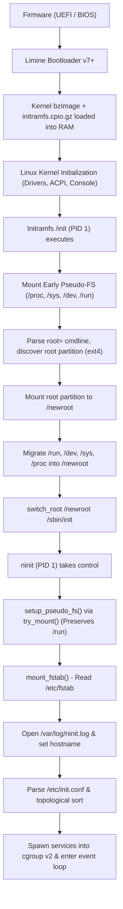

# S.A.N.E Boot Pipeline & Initramfs Architecture

*[English](boot-pipeline.md)*

This document defines the formal boot pipeline for S.A.N.E Linux, from firmware initialization to the non-blocking userspace event loop managed by `ninit` (PID 1). It details partition layout, bootloader configuration, initramfs discovery, filesystem mounting, and the atomic `switch_root` transition to persistent storage.

---

## 1. Pipeline Overview

S.A.N.E supports two operational boot paradigms:
1. **Direct Kernel Boot (Fast CI / QEMU Harness)**: Boots directly into RAM using QEMU `-kernel` and `-initrd`, where `ninit` runs directly as `/sbin/init` inside the uncompressed `initramfs.cpio.gz`. This provides sub-second boot testing with zero disk overhead.
2. **Persistent Disk Boot (Limine + `switch_root`)**: Boots via the Limine bootloader on GPT storage, loads the kernel and minimal initramfs into RAM, mounts the persistent ext4 root partition, and performs a clean `switch_root` transition to `/sbin/init` (`ninit`) on disk.



---

## 2. Storage & Partition Layout (GPT)

For installed systems and disk images (`sane.img`), S.A.N.E standardizes on a 3-partition GPT (GUID Partition Table) layout:

| Partition | Type Code | Type GUID | Filesystem | Recommended Size | Mountpoint | Description |
|---|---|---|---|---|---|---|
| **ESP / Boot (Part 1)** | `ef00` | `C12A7328-F81F-11D2-BA4B-00A0C93EC93B` (EFI System) | FAT32 (vfat) | 64 MB – 256 MB | `/boot` | Contains Limine boot files (`limine-bios.sys`, `limine.conf`, `limine.cfg`), UEFI binaries (`/EFI/BOOT/BOOTX64.EFI`, `/EFI/BOOT/BOOTIA32.EFI`), `bzImage`, and `initramfs.cpio.gz`. |
| **Rootfs (Part 2)** | `8300` | `0FC63DAF-8483-4772-8E79-3D69D8477DE4` (Linux generic) | ext4 | Remainder (>= 256 MB) | `/` | Contains the persistent root filesystem, packages (`/var/lib/spm`), and userspace. |
| **BIOS Boot (Part 3)** | `ef02` | `21686148-6449-6E6F-744E-656564454649` (BIOS boot) | None (Raw) | ~1 MB (sectors 34–2047) | None | Dedicated unformatted partition in the GPT gap used by Limine (`limine bios-install`) to embed its stage 2 bootloader code on BIOS/MBR-booted GPT systems. |

### Role of the BIOS Boot Partition (`bios_boot`, `ef02`)

On traditional MBR-partitioned disks, bootloaders embed stage 2 code in the unpartitioned gap between the MBR (sector 0) and the first partition (typically sector 2048). On GPT disks booted via legacy BIOS, this post-MBR space is occupied by the GPT header (sector 1) and partition entry array (sectors 2–33). To prevent bootloaders from overwriting GPT metadata or relying on filesystem-specific embedding hacks, the GPT specification defines the **BIOS Boot Partition** (`ef02`, GUID `21686148-6449-6E6F-744E-656564454649`).

In S.A.N.E Linux images, Partition 3 occupies sectors 34 to 2047 (1007 KiB). `limine bios-install` identifies this partition and embeds the Limine BIOS stage 2 payload directly into its raw sectors. When booted on legacy BIOS systems, the stage 1 loader in the protective MBR loads stage 2 from Partition 3, which then initializes disk access, reads the FAT32 ESP partition (`boot():`), and executes the boot configuration in `limine.cfg`.

### Limine Bootloader Configuration (`/boot/limine.cfg`)

```ini
TIMEOUT: 3
VERBOSE: no

/S.A.N.E Linux
    PROTOCOL: linux
    KERNEL_PATH: boot():/bzImage
    MODULE_PATH: boot():/initramfs.cpio.gz
    CMDLINE: console=ttyS0 console=tty0 root=PARTUUID=44444444-4444-4444-8888-888888888888 rootfstype=ext4 rw quiet
```

- **BIOS Boot**: Stage 1 installed to MBR/GPT protective header and Stage 2 embedded in Partition 3 (`bios_boot`) via `limine bios-install` or `limine-deploy`.
- **UEFI Boot**: Standard `\EFI\BOOT\BOOTX64.EFI` and `\EFI\BOOT\BOOTIA32.EFI` located on the FAT32 ESP partition (Partition 1).

---

## 3. Kernel Entry & Initramfs Environment

When the Linux kernel boots:
1. It decompresses itself into high memory, calibrates timers, initializes CPU cores, and sets up early console logging via `console=ttyS0` and `console=tty0`.
2. The kernel unpacks `initramfs.cpio.gz` into the rootfs memory store (a `ramfs` / `tmpfs` instance).
3. The kernel attempts to execute `/init` as PID 1.

### Initramfs Responsibilities (`/init`)

The initramfs `/init` script is a minimal, fail-closed POSIX shell script built on BusyBox static applets:

```sh
#!/bin/sh
# /init -- S.A.N.E minimal initramfs entrypoint
set -eu

# 1. Mount essential early pseudo-filesystems
mkdir -p /proc /sys /dev /run /newroot
mount -t proc proc /proc
mount -t sysfs sysfs /sys
mount -t devtmpfs devtmpfs /dev
mount -t tmpfs tmpfs /run

# 2. Parse command line for root device
ROOT_DEV=""
for arg in $(cat /proc/cmdline); do
    case "$arg" in
        root=*) ROOT_DEV="${arg#root=}" ;;
    esac
done

[ -n "$ROOT_DEV" ] || {
    echo "ERROR: No root= parameter specified on kernel command line!"
    exec /bin/sh
}

# 3. Resolve UUID or device path (settling devtmpfs)
if echo "$ROOT_DEV" | grep -q "^PARTUUID="; then
    RESOLVED_DEV=$(blkid -t "$ROOT_DEV" -o device || true)
elif echo "$ROOT_DEV" | grep -q "^UUID="; then
    RESOLVED_DEV=$(blkid -t "$ROOT_DEV" -o device || true)
else
    RESOLVED_DEV="$ROOT_DEV"
fi

# Wait for block device (up to 5 seconds)
COUNT=0
while [ ! -b "$RESOLVED_DEV" ] && [ $COUNT -lt 50 ]; do
    sleep 0.1
    COUNT=$((COUNT + 1))
done

[ -b "$RESOLVED_DEV" ] || {
    echo "ERROR: Root device $RESOLVED_DEV not found after timeout!"
    exec /bin/sh
}

# 4. Mount target root filesystem
mount -t ext4 -o ro "$RESOLVED_DEV" /newroot

# 5. Move pseudo-filesystems into newroot to preserve state across handoff
mount --move /run /newroot/run
mount --move /dev /newroot/dev
mount --move /sys /newroot/sys
mount --move /proc /newroot/proc

# 6. Clean switch_root handoff to ninit
exec switch_root /newroot /sbin/init "$@"
```

---

## 4. The `switch_root` Transition

The `switch_root` utility is critical for transitioning from initramfs to persistent storage without leaking memory or leaving zombie mount namespaces.

### System Call Sequence & Operation
When `switch_root /newroot /sbin/init` executes:
1. **Safety Assertions**:
   - Confirms the calling process is PID 1.
   - Verifies `/newroot` is a separate mountpoint (`st_dev` differs from root).
2. **RAM Reclamation**:
   - Recursively deletes all files and directories on the old rootfs (the initramfs tmpfs). This immediately returns all initramfs memory back to the kernel page allocator, preserving S.A.N.E's `< 30 MB` RAM footprint.
3. **Mount Migration**:
   - Over-mounts `/newroot` onto `/` (using `pivot_root` or `mount --move`).
4. **Namespace Realignment**:
   - Executes `chroot(".")` and `chdir("/")` so that root directory references point to the persistent disk rootfs.
5. **PID 1 Replacement**:
   - Invokes `execve("/sbin/init", ["/sbin/init"], environ)`.
   - The `/init` shell process is replaced by `ninit`, which inherits PID 1.

---

## 5. `ninit` PID 1 Initialization & `try_mount` Idempotency

Once `ninit` takes control as PID 1, it executes its deterministic startup sequence in `main()`:

```
Verify getpid() == 1  ->  umask(022)  ->  Block signals & initialize empty mask sigemptyset(&orig)
   ->  Install sigaction handlers (SIGCHLD/SIGTERM/SIGINT/SIGUSR1/SIGUSR2) + ignore SIGPIPE
   ->  setup_pseudo_fs()          mounts proc, sysfs, devtmpfs, tmpfs on /run & /tmp, cgroup2
   ->  mount_fstab()              mounts filesystems from /etc/fstab
   ->  Open /var/log/ninit.log, emit startup banner
   ->  set_hostname()             read from /etc/hostname
   ->  parse_config(argv[1] or /etc/init.conf)   failure => rescue shell (/bin/sh)
   ->  validate_dependencies()    missing dependency => rescue shell (/bin/sh)
   ->  sort_services()            DFS topological sort; cycles => rescue shell (/bin/sh)
   ->  setup_initctl() (/run/initctl), setup_log_fifo() (/run/log.fifo)
   ->  spawn_service() for all configured services
   ->  Log "main loop ready"  ->  for (;;) event loop
```

### 5.1 Idempotent Mounting via `try_mount()`

When `switch_root` has already moved active mounts (`/run`, `/proc`, `/sys`, `/dev`) into `/newroot`, `ninit` must not fail with `EBUSY` when attempting to mount them.

In `ninit.c`:

```c
static void try_mount(const char *src, const char *tgt, const char *fstype, unsigned long flags)
{
    mkdir(tgt, 0755);
    if (is_mounted(tgt)) {
        init_log("%s: %s already mounted", fstype, tgt);
        return;
    }
    if (mount(src, tgt, fstype, flags, NULL) < 0)
        init_log("mount %s -> %s failed: %s", src, tgt, strerror(errno));
}
```

#### How `is_mounted(tgt)` Preserves Pre-mounted Filesystems:
1. `is_mounted()` reads `/proc/mounts`. If `/proc` was pre-mounted across `switch_root`, it iterates line-by-line comparing mount target paths (`tgt`).
2. If the mountpoint matches (e.g. `/run`), `is_mounted()` returns `1`.
3. `try_mount()` logs `tmpfs: /run already mounted` and **returns immediately without making a redundant `mount(2)` system call**.
4. **Fallback Handling**: If `/proc` is not yet available, `is_mounted()` compares the `st_dev` device identifier of the target directory against its parent (`tgt/..`). If device IDs differ, the directory is confirmed to be an existing mountpoint.

This design guarantees seamless compatibility whether booted directly in an initramfs or transitioned via `switch_root`.

### 5.2 Cgroup v2 Unified Hierarchy Setup

Following pseudo-filesystem mounting, `setup_pseudo_fs()` ensures the unified cgroup v2 tree is mounted and active:

```c
/* cgroup v2 (unified): mount only if not already mounted */
if (stat("/sys/fs/cgroup/cgroup.controllers", &st) == 0) {
    init_log("cgroup2: /sys/fs/cgroup already mounted");
} else {
    mkdir("/sys/fs/cgroup", 0755);
    if (mount("cgroup2", "/sys/fs/cgroup", "cgroup2", 0, NULL) < 0)
        init_log("cgroup2: mount /sys/fs/cgroup failed: %s", strerror(errno));
    else
        init_log("cgroup2: /sys/fs/cgroup mounted");
}
enable_cgroup_subtree("/sys/fs/cgroup/cgroup.subtree_control");
```

Controllers `+memory +cpu +pids` are enabled at the root so that each service spawned into `/sys/fs/cgroup/ninit/<name>` inherits kernel resource accounting.

### 5.3 Filesystem Mounting (`mount_fstab()`)

`mount_fstab()` reads `/etc/fstab` on the target disk. It remounts `/` read-write if specified (`/dev/root / ext4 rw,relatime 0 1`) and mounts remaining partitions (`/home`, `/boot`, `/var`). Note that `mount_fstab()` executes before `/var/log/ninit.log` is opened, ensuring errors are visible on `/dev/console` and `/dev/kmsg`.

---

## 6. Service Supervision & Non-Blocking Event Loop

With filesystems mounted:
1. **Hostname**: Read from `/etc/hostname` and set via `sethostname()`.
2. **Configuration**: Parsed from `/etc/init.conf`.
3. **Dependency Graph**: Validated for missing nodes and topologically sorted with cycle detection.
4. **IPC Endpoints**: Created at `/run/initctl` (command FIFO) and `/run/log.fifo` (logging pipe).
5. **Event Loop**: Services are spawned into leaf cgroups. `ninit` enters its non-blocking `ppoll(..., 100ms)` event loop, reaping terminated children and listening for operator commands.

---

## 7. Failure Recovery & Rescue Shell Contract

S.A.N.E enforces a fail-closed boot contract:

| Boot Failure Stage | Trigger | Recovery Action |
|---|---|---|
| **Initramfs Root Discovery** | Missing or unreadable `root=` device | Drops into initramfs `/bin/sh` emergency shell with interactive tty. |
| **Root Filesystem Corrupt** | `mount` of `/newroot` fails | Halts boot and opens emergency shell for `fsck.ext4` intervention. |
| **`ninit` Missing / Invalid Config** | Missing `/etc/init.conf` or syntax error | `enter_rescue_mode()`: Clears signal mask (`sigprocmask`), resets `SIGPIPE`, closes FIFOs, and launches `/bin/sh`. |
| **Dependency Missing or Cycle** | `:requires=unknown` or cyclical graph | `enter_rescue_mode()`: Halts half-configured boot and launches `/bin/sh`. |

In rescue mode, interactive control (Ctrl+C, job control) is fully restored, enabling administrator diagnosis and repair.
