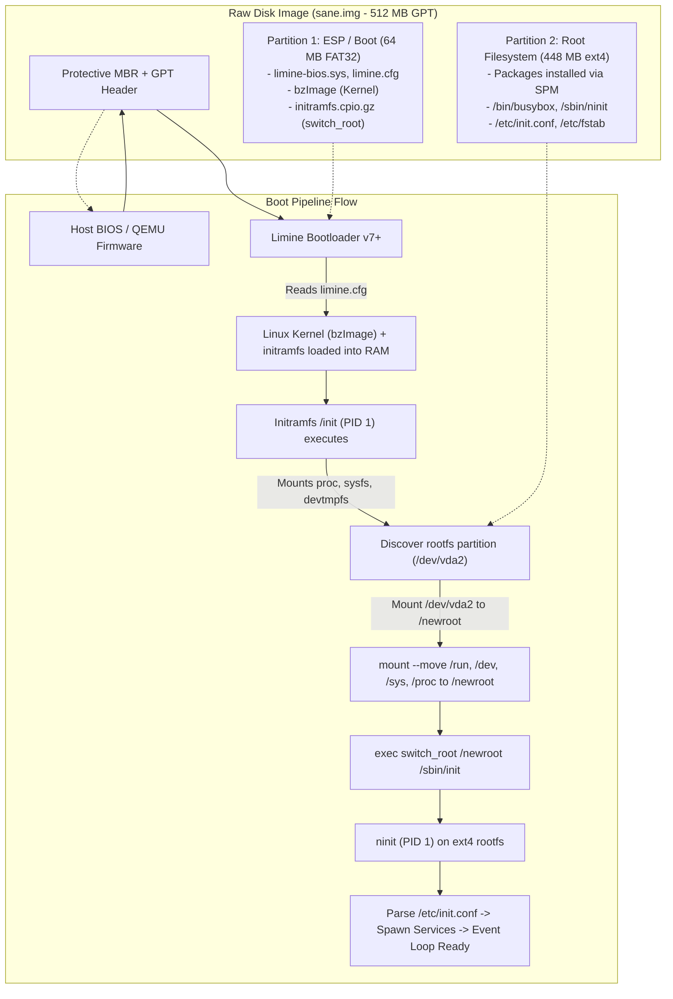

# S.A.N.E Distro Image Builder & Limine Boot Architecture

*[English](distro-image-builder.md)*

This document specifies the technical architecture, storage layout, bootloader configuration, and automated headless verification for the S.A.N.E Linux raw GPT disk image (`sane.img`), constructed via `scripts/make-image.sh` and verified via `scripts/test-image-boot.sh`.

---

## 1. Architectural Overview

S.A.N.E Linux disk images deliver a production-ready, bootable operating system appliance contained in a single 512 MB raw image. Unlike ephemeral direct-kernel boots (`-kernel` and `-initrd`), the disk image represents a true bare-metal or hypervisor boot pipeline utilizing the Limine BIOS bootloader, a dual-partition GUID Partition Table (GPT), an early initramfs with `switch_root` root pivoting, and the `ninit` userspace init daemon running as PID 1 on persistent storage.



---

## 2. Storage & Partition Layout (Dual-Partition GPT)

The disk image is formatted with a standard GUID Partition Table (GPT) to support modern UEFI and legacy BIOS compatibility.

### 2.1 Partition Table Scheme

| Partition | Start Sector | End Sector | Size | Partition Type | Type GUID | Label | Filesystem | Mountpoint |
|---|---|---|---|---|---|---|---|---|
| **1 (ESP / Boot)** | `2048` | `133119` | 64 MB | EFI System (`ef00`) | `C12A7328-F81F-11D2-BA4B-00A0C93EC93B` | `SANE_BOOT` | FAT32 (`vfat`) | `/boot` |
| **2 (Rootfs)** | `133120` | `1048542` | 448 MB | Linux Filesystem (`8300`) | `0FC63DAF-8483-4772-8E79-3D69D8477DE4` | `sane_root` | ext4 | `/` |

### 2.2 Partition 1: ESP / Boot Partition
- **Filesystem**: FAT32 (`mkfs.vfat -F 32 -n SANE_BOOT`).
- **Contents**:
  - `limine-bios.sys`: Limine BIOS stage 2 payload.
  - `limine.cfg`: Bootloader menu and kernel launch configuration.
  - `bzImage`: Linux kernel binary (Alpine virt kernel or host kernel).
  - `initramfs.cpio.gz`: Early userspace archive containing BusyBox applets and `/init`.

### 2.3 Partition 2: Persistent Root Filesystem
- **Filesystem**: ext4 (`mkfs.ext4 -L sane_root -O ^metadata_csum_seed`).
- **Contents**:
  - Installed base packages deployed deterministically via `spm install --root <target>`:
    - `busybox`: Core utilities and shell symlinks in `/bin` and `/usr/bin`.
    - `ninit`: PID 1 init daemon installed as `/sbin/init` and `/sbin/ninit`.
    - `limine-static`: Static Limine deployment tools.
    - `kernel`: Kernel packaging and module hierarchy.
    - `sane-hello`: Demonstration one-shot service utility.
  - Configuration files:
    - `/etc/fstab`: Filesystem mount definitions (`/dev/vda2 / ext4 rw,relatime 0 1`, `/dev/vda1 /boot vfat defaults 0 2`).
    - `/etc/hostname`: Host identity (`S.A.N.E`).
    - `/etc/init.conf`: Service definitions (`console:respawn:/bin/sh`, `sane-hello:once:/usr/bin/sane-hello`).

---

## 3. Limine BIOS Bootloader Configuration

S.A.N.E adopts Limine as its standard bootloader due to its minimalist design, zero external runtime dependencies, native Linux boot protocol compliance, and dual BIOS/UEFI support.

### 3.1 Limine Configuration (`/boot/limine.cfg`)

```ini
TIMEOUT: 1
VERBOSE: no

/S.A.N.E Linux
    PROTOCOL: linux
    KERNEL_PATH: boot():/bzImage
    MODULE_PATH: boot():/initramfs.cpio.gz
    CMDLINE: console=ttyS0 console=tty0 root=/dev/vda2 rootfstype=ext4 rw quiet panic=-1
```

- **`PROTOCOL: linux`**: Launches the kernel using the standard 64-bit Linux boot protocol.
- **`KERNEL_PATH: boot():/bzImage`**: References the kernel binary on the boot partition (`boot():`).
- **`MODULE_PATH: boot():/initramfs.cpio.gz`**: Loads the initramfs into RAM alongside the kernel.
- **`CMDLINE` parameters**:
  - `console=ttyS0 console=tty0`: Multiplexes kernel and init output to the first serial port (ttyS0) for headless logging and the virtual VGA console.
  - `root=/dev/vda2`: Specifies the root filesystem block device (virtio-blk partition 2).
  - `rootfstype=ext4`: Explicit filesystem type to avoid heuristic autodetection latency.
  - `rw`: Mounts root read-write upon switch.
  - `panic=-1`: Instructs the kernel to halt/power down immediately on panic without reboot delay.

### 3.2 BIOS MBR/GPT Stage 1 Installation

Limine is embedded into the disk image's protective MBR and GPT partition boundary sectors:

```bash
limine bios-install distro/sane.img
```

This ensures that legacy BIOS systems and virtual machine hypervisors (such as QEMU SeaBIOS) can read the partition table and transfer control to `limine-bios.sys`.

---

## 4. Initramfs Architecture & `switch_root` Handoff

The transition from RAM-based initramfs to persistent storage is performed atomically using `switch_root`.

### 4.1 Initramfs Sequence (`/init`)

The minimal initramfs `/init` executes as PID 1 immediately after kernel decompression:

```sh
#!/bin/sh
set -eu

# 1. Mount essential early pseudo-filesystems
mkdir -p /proc /sys /dev /run /newroot
mount -t proc proc /proc
mount -t sysfs sysfs /sys
mount -t devtmpfs devtmpfs /dev
mount -t tmpfs -o mode=0755,nosuid,nodev tmpfs /run

# 2. Parse command line for root device
ROOT_DEV="/dev/vda2"
for arg in $(cat /proc/cmdline); do
    case "$arg" in
        root=*) ROOT_DEV="${arg#root=}" ;;
    esac
done

# 3. Wait for block device with timeout
COUNT=0
while [ ! -b "$ROOT_DEV" ] && [ $COUNT -lt 50 ]; do
    sleep 0.1
    COUNT=$((COUNT + 1))
done

[ -b "$ROOT_DEV" ] || {
    echo "ERROR: Root device $ROOT_DEV not found after timeout!"
    exec /bin/sh
}

# 4. Mount target root filesystem
mount -t ext4 -o rw "$ROOT_DEV" /newroot

# 5. Move pseudo-filesystems into newroot
mount --move /run /newroot/run
mount --move /dev /newroot/dev
mount --move /sys /newroot/sys
mount --move /proc /newroot/proc

# 6. Execute switch_root handoff to ninit
echo "switch_root: pivoting to $ROOT_DEV"
exec switch_root /newroot /sbin/init "$@"
```

### 4.2 State Preservation & `try_mount()` Idempotency

When `/init` moves `/run`, `/dev`, `/sys`, and `/proc` into `/newroot`, these filesystems remain mounted when `ninit` initializes. In `ninit.c`, `try_mount()` inspects `/proc/mounts` and the device ID of target directories:
- If `/run` is already mounted as `tmpfs`, `try_mount()` logs `tmpfs: /run already mounted` and bypasses the `mount(2)` syscall, preventing `EBUSY` errors.
- `/dev` maintains active device nodes, ensuring console descriptors (`/dev/console`, `/dev/kmsg`) remain valid throughout the handoff.

---

## 5. Headless Verification Guide (`scripts/test-image-boot.sh`)

Automated validation verifies that `sane.img` boots completely without human intervention in continuous integration (CI) and headless test environments.

### 5.1 Invocation

```bash
# Direct test execution
bash scripts/test-image-boot.sh

# Or via Makefile
make test-image
```

If `distro/sane.img` does not exist, the test harness automatically calls `sudo bash scripts/make-image.sh` to generate the image.

### 5.2 QEMU Headless Parameters

The test harness runs QEMU in non-interactive headless mode:

```bash
qemu-system-x86_64 \
    -drive file=distro/sane.img,format=raw,if=virtio \
    -m 128M \
    -serial file:distro/qemu-image-console.log \
    -display none \
    -no-reboot
```

- `-drive file=distro/sane.img,format=raw,if=virtio`: Attaches the disk image as a virtual block device (`/dev/vda`).
- `-m 128M`: Constrains memory to 128 MB to verify S.A.N.E's ultra-low memory footprint.
- `-serial file:<path>`: Redirects guest serial UART directly to a file descriptor on the host, capturing boot logs synchronously without PTY allocation.
- `-display none`: Disables graphical window creation.
- `-no-reboot`: Exits the emulator if the guest triggers reboot or shutdown.

### 5.3 Assertion Pipeline & Diagnostic Log

The test harness enforces the following deterministic markers within a 15-second bounded loop:

1. **`switch_root` Execution**: Confirms root filesystem pivoting:
   - Matches: `switch_root: pivoting to /dev/vda2` or `switch_root` mount activity.
2. **`ninit` PID 1 Startup**:
   - Matches: `ninit start (PID 1)` and `=== ninit start (PID 1)`.
3. **Event Loop Readiness**:
   - Matches: `main loop ready`.
4. **Service Execution**:
   - Matches: `started console` or `started sane-hello` or `Hello from S.A.N.E Linux!`.
5. **Zero Kernel Panic Assertion**:
   - Matches absence of: `Kernel panic`, `Attempted to kill init!`, `end Kernel panic`.

### 5.4 Exit Status Contract

- **`0` (PASS)**: All boot markers verified successfully within the timeout window. Full console trace and milestone timing recorded.
- **`1` (FAIL)**: Missing milestone, kernel panic detected, or process timeout. The full diagnostic serial log is dumped to stderr for post-mortem debugging.
