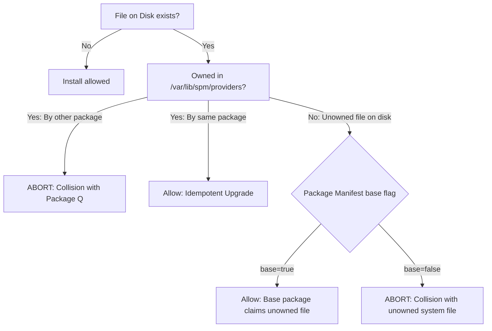

# S.A.N.E Package Manager (`spm`) Architecture & CLI Reference

*[English](package-manager.md)*

This document defines the formal architecture, flat-file database layout, concurrency locking contracts, security invariants, and CLI command interface for the S.A.N.E Package Manager (`spm`).

---

## 1. Executive Summary & Core Tenets

The S.A.N.E Package Manager (`spm`) is a lightweight, standalone, POSIX-compliant package management system written in Bash. It provides deterministic package lifecycle management, atomic transactions, cryptographic integrity verification, and safe uninstallation for S.A.N.E Linux appliances and distributions.

### Core Architectural Tenets
1. **Offline-First & Self-Contained**: `spm` operates entirely offline without mandatory network repositories or daemon dependencies. Packages are distributed as local cryptographically verified `.spm.tar.xz` (or `.spm.tar.gz`) containers.
2. **Fail-Closed Atomic Transactions & Unified Rollback**: Every install transaction executes in isolated staging. Checksums, manifest parity, dependencies, path security, and declarative service snippets are verified before a single byte touches the target filesystem. A unified rollback journal snapshots both filesystem replacements and database state (`installed/<pkg>`, `providers`, `rdeps`, `world`). Any fault during file commit or database update triggers a full transactional rollback restoring both the filesystem and database to their exact pre-transaction state.
3. **ETXTBSY Immunity (Atomic `rename(2)` Replacement)**: Files and running daemons are deployed strictly using `mv` (atomic `rename(2)` / dentry replacement), completely avoiding in-place `cp` truncation or write operations that produce Linux `ETXTBSY` ("Text file busy") errors.
4. **Anti-Traversal & Destination Symlink Guard**: Archives and manifests are pre-audited. Relative path traversal (`..`), leading slashes (`/`), double slashes (`//`), invalid characters, escaping symlinks, and existing destination path components resolving outside `TARGET_ROOT` are rejected with immediate failure.
5. **Strict 1:1 Manifest & Checksum Parity**: Every entry in `.META/files` must bidirectionally match `./x/` payload files, preventing unrecorded payload files or ghost entries. Cryptographic verification mandates `.META/sha256` with 64-character hex digests and an exact 1:1 match for every regular file.
6. **Package Upgrade Cleanup of Obsolete Files**: On self-upgrade, obsolete files present in the previous package version but omitted from the new version are safely pruned bottom-up and stripped from `providers`, with automatic backup into the rollback journal for rollback protection.
7. **Safe Bottom-Up Removal (Zero `rm -rf`)**: File deletion traverses in reverse depth order. Directories are pruned exclusively via `rmdir` on empty nodes (`rmdir 2>/dev/null || true`), strictly preventing accidental destruction of shared system directories (`/usr/bin`, `/etc`).
8. **Declarative Service Integration (No Shell Hooks)**: Packages cannot execute arbitrary pre/post-install shell hooks. Daemons integrate solely via declarative single-line `ninit` service snippets placed under `/usr/share/ninit/services/`.

---

## 2. Flat-File Database Layout (`/var/lib/spm/`)

The `spm` database resides at `/var/lib/spm/` (or `<root>/var/lib/spm/` when invoked with `--root <path>`). All database records use human-readable, line-delimited flat files easily inspected and debugged with standard coreutils (`cat`, `grep`, `awk`, `sort`):

```
/var/lib/spm/
├── installed/                          # Per-package installation records
│   ├── busybox/
│   │   ├── package                     # Manifest (name, version, release, arch, base)
│   │   ├── files.list                  # Absolute installed paths (/bin/busybox, /bin/sh)
│   │   ├── sha256                      # SHA-256 digests for regular files
│   │   ├── depends                     # Line-separated dependency declarations
│   │   └── version                     # Upstream version and release (<version>-<release>)
│   └── sane-hello/
│       ├── package
│       ├── files.list
│       ├── sha256
│       ├── depends
│       └── version
├── providers                           # Global reverse index: <absolute_path>\t<pkg-name>
├── rdeps/                              # Reverse dependency tracking: <dependency>\t<dependent>
│   └── busybox                         # Lists packages dependent on busybox (e.g. sane-hello)
├── world                               # Set of explicitly requested packages (sorted, unique)
├── staging/                            # Scratch directory for ephemeral staging transactions
└── spm.lock                            # Exclusive flock advisory lock for concurrency protection
```

### Database Component Specifications

| File / Directory | Format | Invariant / Purpose |
|---|---|---|
| `installed/<name>/package` | `key=value` pairs | Immutable record of the installed package manifest. |
| `installed/<name>/files.list` | Normalized absolute paths | Sorted list of all installed files, symlinks, and directories. |
| `installed/<name>/sha256` | `<hash>  <relpath>` | Checksums recorded at package build time. |
| `installed/<name>/depends` | One package name per line | Direct dependencies declared by this package. |
| `installed/<name>/version` | `<version>-<release>` | Package release version for fast O(1) query. |
| `providers` | `<path>\t<pkg-name>` | Sorted unique tab-separated reverse path index for conflict detection and `query`. |
| `rdeps/<dep-name>` | `<dep>\t<pkg>` | Reverse dependency tracking preventing premature removal of required packages. |
| `world` | One package name per line | Canonical set of user-installed packages. |
| `staging/` | Ephemeral scratch directory | Holds `tx-<pkg>-<pid>` trees during verification and commit. Purged upon completion. |
| `spm.lock` | Empty lockfile | Target for `flock(1)` serialization across concurrent operations. |

---

## 3. Concurrency & Locking Contract

To ensure transaction isolation across concurrent package manager instances:

1. **Lock Mechanism**: Concurrency safety is enforced using Linux kernel file locks via `flock(1)`.
2. **Exclusive Mutation Lock (`flock -x`)**:
   - Subcommands that alter persistent filesystem state or database records (`init`, `install`, `remove`) acquire an exclusive lock on `/var/lib/spm/spm.lock`.
   - If another `spm` process currently holds the lock, the incoming instance logs a wait notice and blocks until the active transaction completes:
     ```bash
     exec 9>"$LOCK_FILE"
     flock -x 9
     ```
3. **Shared Read Lock (`flock -s`)**:
   - Query subcommands (`list`, `info`, `query`) acquire a shared read lock on `/var/lib/spm/spm.lock`. Multiple concurrent readers can execute in parallel without reading intermediate uncommitted states during an ongoing `install` or `remove`.
4. **Fail-Closed Unlock Guarantee**:
   - Lock file descriptors are tied to shell process descriptors. In the event of an unhandled crash, `SIGKILL`, or `set -e` abort, the kernel automatically closes open file descriptors and releases held locks immediately.

---

## 4. CLI Subcommand Reference

`spm` provides a standard UNIX-style command interface. The global option `--root <path>` (or `-r <path>`) allows operating against offline targets, chroot trees, or mounted installation media.

### Synopsis
```bash
spm [OPTIONS] <subcommand> [ARGS...]
```

### Global Options
- `-r, --root <path>`: Direct operations to an alternate root directory `<path>` (default: `/`).
- `-h, --help`: Display usage summary and exit.
- `-v, --version`: Display `spm` version information.

---

### 4.1 `spm init`
Initializes the flat-file database layout under `/var/lib/spm/` if it does not already exist.

```bash
# Initialize host database
spm init

# Initialize offline target rootfs
spm init --root /mnt/target
```

**Actions**:
- Creates `installed/`, `rdeps/`, and `staging/` directories.
- Touches empty `providers`, `world`, and `spm.lock` files.

---

### 4.2 `spm list`
Lists all currently installed packages along with their version, build release, target architecture, and base flag.

```bash
spm list [--root <path>]
```

**Example Output**:
```text
busybox 1.36.1-1 x86_64 base=true
kernel 6.6.134-1 x86_64 base=true
limine-static 12.9.6-1 x86_64 base=true
ninit 1.1.0-1 x86_64 base=true
sane-hello 0.1.0-1 x86_64 base=false
```

---

### 4.3 `spm info <pkg-name>`
Displays detailed metadata, description, and dependencies for an installed package.

```bash
spm info sane-hello [--root <path>]
```

**Example Output**:
```text
Name: sane-hello
Version: 0.1.0
Release: 1
Architecture: x86_64
Base: false
Description: Minimal test package for S.A.N.E Linux
Dependencies: busybox
```

---

### 4.4 `spm query <path>`
Finds which installed package owns a given absolute or relative filesystem path using the `providers` reverse index.

```bash
# Query absolute binary path
spm query /usr/bin/sane-hello

# Query relative path or with offline root
spm query usr/bin/sane-hello --root /mnt/target
```

**Output**:
```text
/usr/bin/sane-hello is provided by sane-hello
```

If no package provides the path, `spm` exits with code `1`:
```text
ERROR: No package provides /usr/bin/unknown
```

---

### 4.5 `spm install <archive.spm.tar.xz>`
Installs a package archive into the target filesystem using a 6-stage atomic transaction.

```bash
spm install /distro/packages/sane-hello-0.1.0-1-x86_64.spm.tar.xz [--root <path>]
```

**Transaction Stages**:
1. **Archive Security Audit**: Pre-inspects archive member names and symlink targets with `tar -tf` and `tar -tvf` before uncompressing payload. Rejects path traversal (`..`), leading slashes, and escaping symlinks.
2. **Metadata & Dependency Audit**: Reads `.META/package` and `.META/depends` directly from archive. Validates name syntax, architecture compatibility (`x86_64` or `all`), and verifies all required dependency packages are already present in `/var/lib/spm/installed/`.
3. **Collision Detection & Destination Symlink Guard**:
   - Inspects `.META/files` line-by-line: rejects empty entries, leading slashes, double slashes (`//`), path traversal (`..`), dot segments, and invalid characters (`^[a-zA-Z0-9._/+-]+$`).
   - Deep inspection of all destination directory path components under `TARGET_ROOT`: rejects any path component resolving outside `TARGET_ROOT` via existing filesystem symlinks.
   - Audits payload paths against `/var/lib/spm/providers`:
     - If a path is already owned by another package: **ABORT (Conflict)**.
     - If a path exists on disk but is unrecorded in `providers`:
       - If `base=true`: allowed to claim unowned file (rootfs bootstrap).
       - If `base=false`: **ABORT (Unowned file collision)**.
     - If a path is owned by the same package: allowed (idempotent self-upgrade).
4. **Staging Extraction, Parity & Checksum Verification**:
   - Extracts archive to scratch directory `/var/lib/spm/staging/tx-<pkg>-<pid>/`.
   - **Bidirectional 1:1 Manifest Parity**: Compares `.META/files` against actual entries in `./x/` payload. Rejects ghost entries (in manifest but missing in payload) and unrecorded entries (in payload but missing from manifest). Rejects duplicate entries.
   - **Fail-Closed SHA-256 Verification**: Mandates `.META/sha256` exists. Validates 64-character hex digests. Enforces exact 1:1 match across all regular files in payload (every regular file must have a checksum, and every checksum must correspond to a regular file).
   - Validates declarative `ninit` service snippets (single line, no shell metacharacters, no system state or IPC keywords).
5. **Atomic Commit via `rename(2)` & Obsolete File Pruning**:
   - **Unified Rollback Journal**: Snapshots pre-install database state (`installed/<pkg>`, `providers`, `rdeps`, `world`) and initializes filesystem rollback records (`created` and `backup`) in `/var/lib/spm/staging/tx-<pkg>-<pid>/.journal/`.
   - Re-verifies destination directory path components against symlink escapes under `TARGET_ROOT`.
   - Moves files into destination root using `mv -f` (calling `rename(2)` / atomic dentry replacement). Backs up replaced files into rollback backup.
   - **Obsolete File Pruning on Self-Upgrade**: Compares old `installed/<pkg>/files.list` against new manifest. Obsolete files absent in the new version are safely moved to the rollback backup (pruned from disk, preserved for rollback), and empty obsolete directories are pruned bottom-up.
   - **Unified Fault Recovery**: If any failure occurs during file movement or subsequent database commit, automated rollback restores both the filesystem (restoring regular files and symlinks from backup via `find \( -type f -o -type l \) -print0`, purging created files) and database state from the journal.
6. **Database Commit & Journal Cleanup**:
   - Updates `installed/<pkg>/` (`package`, `sha256`, `depends`, `version`, `files.list`).
   - Updates `providers` index: removes all old package entries and registers new payload files.
   - Updates `rdeps/` reverse dependency index and `world` manifest.
   - Atomically completes transaction, cleans up staging scratch directory, and releases lock.

---

### 4.6 `spm remove <pkg-name>`
Safely uninstalls a package from the system using reverse depth bottom-up file removal.

```bash
spm remove sane-hello [--root <path>]
```

**Removal Stages**:
1. **Reverse Dependency Check**: Checks `/var/lib/spm/rdeps/<pkg-name>`. If any installed package still depends on this package, uninstallation is blocked:
   ```text
   ERROR: Cannot remove 'busybox': required by dependent package(s): sane-hello
   ```
2. **Bottom-Up File Removal**: Reads `/var/lib/spm/installed/<pkg-name>/files.list`. Sorts entries in reverse depth order (deepest files and symlinks first, then child directories, then parent directories).
   - Regular files and symlinks: removed using `rm -f -- "$path"` (no dereferencing).
   - Directories: pruned using `rmdir "$dir" 2>/dev/null || true` (removes empty directories only; shared directories with remaining files are safely preserved).
3. **Database Cleanup**: Removes package records from `providers`, updates `rdeps/` of packages it depended on, strips package from `world`, and deletes `/var/lib/spm/installed/<pkg-name>/`.

---

## 5. Declarative Service Snippet Integration (`ninit`)

`spm` enforces strict security constraints on system services provided by packages:

### File Location & Permissions
- Service snippets must reside in `./x/usr/share/ninit/services/<name>.service`.
- Filename must end in `.service`.
- Snippet files are strictly non-executable regular files forced to mode `0644`. Symlinks are rejected.

### File Format & Invariants
- Each snippet consists of strictly a single line defining the service:
  ```
  [(<name>):](once|respawn):<command> [<args>...] [:<option>=<val>...]
  ```
  Examples:
  ```text
  sane-hello:once:/usr/bin/sane-hello
  respawn:/usr/sbin/sshd -D
  sane-hello:once:/usr/bin/sane-hello:memory_max=8M:timeout=10
  ```

### Forbidden Pattern Checks
`spm` rejects any package containing a service snippet that contains:
1. IPC control paths: `/run/initctl`
2. Direct system state commands: `reboot`, `poweroff`, `halt`, `kill`, `signal`
3. Shell metacharacters / redirects / pipes: `|`, `>`, `<`, `;`, `&`, '`', `$`

### Hook Ban
`spm` strictly forbids pre-install or post-install shell hooks. `spm` never writes to `/run/initctl` or signals PID 1. Services become active only when explicitly added to `/etc/init.conf` and the system restarts.

---

## 6. Base Package Semantics (`base=true` vs `base=false`)

The manifest field `base` distinguishes core operating system packages from user applications:



- **`base=true`**: Reserved for foundational distro components (`busybox`, `ninit`, `kernel`, `limine-static`). During appliance image generation or bootstrap, base packages are authorized to claim pre-existing unowned files on disk.
- **`base=false`**: Standard user-space packages. User packages must never overwrite pre-existing unmanaged system files or collide with files owned by other packages.

---

## 7. Security & Hardening Matrix

| Threat Vector | Mitigation Technique | Enforcement Point |
|---|---|---|
| **Tar-Slip Directory Traversal** | Pre-extraction inspection of member names with `tar -tf`. Rejection of `..` and leading `/`. | Stage 1 (Pre-extraction) |
| **Manifest Path Traversal & Injection** | Line-by-line validation of `.META/files`: rejection of leading slashes, double slashes (`//`), `..`, dot segments, and characters outside `[a-zA-Z0-9._/+-]`. | Stage 3 (Pre-extraction) & Stage 4 |
| **Payload Manifest Parity Desync** | Bidirectional 1:1 verification between `.META/files` and extracted `./x/` payload. Rejects ghost manifest entries and unrecorded payload files. | Stage 4 (Staging verification) |
| **Fail-Closed Checksum Bypass** | Mandatory `.META/sha256` manifest, 64-character hex format validation, and strict 1:1 match for every regular file in payload. | Stage 4 (Staging verification) |
| **Symlink Escape Attack (Payload)** | Traversal calculation of relative symlinks (`cur_depth >= 0`). Whitelisting of absolute symlink roots (`/bin`, `/sbin`, `/usr/bin`, `/usr/sbin`, `/lib`, `/usr/lib`, `/usr/share`). Explicit ban on sensitive paths (`/etc/shadow`, `/etc/passwd`, `/proc`, `/sys`, `/dev`, `/root`, `/home`). | Stage 1 (Pre-extraction) |
| **Destination Directory Symlink Escape** | Deep inspection of all directory path components under `TARGET_ROOT` prior to writing; aborts if any component resolves outside target root. | Stage 3 (Pre-extraction) & Stage 5 |
| **Package Upgrade File Residue** | Automatic delta analysis between old `files.list` and new manifest; obsolete files are safely pruned bottom-up and stripped from `providers`. | Stage 5 (Commit) & Stage 6 (DB) |
| **Concurrent Mutation Race** | Kernel `flock(1)` exclusive locks on `/var/lib/spm/spm.lock`. Shared locks for reads. | Lock initialization |
| **ETXTBSY on Running Daemons** | Atomic replacement via `mv -f` (`rename(2)` dentry replacement) instead of in-place `cp`. | Stage 5 (Commit) |
| **Mid-Install I/O or DB Failure** | Unified rollback journal snapshotting database state and replaced files. Restores both filesystem (regular files and symlinks via `find \( -type f -o -type l \)`) and database on any error. | Stage 5 & 6 (Rollback handler) |
| **Supply-Chain Service Hijack** | Ban on executable hooks, restriction to single-line declarative `type:command` service definitions, regex verification, and keyword filtering. | Stage 4 (Staging verification) |
| **Accidental System Destruction** | Strict bottom-up file removal with `rm -f -- "$path"`. Pruning of directories exclusively via `rmdir` on empty nodes. Zero `rm -rf` on rootfs paths. | Stage 1 (Removal) |
