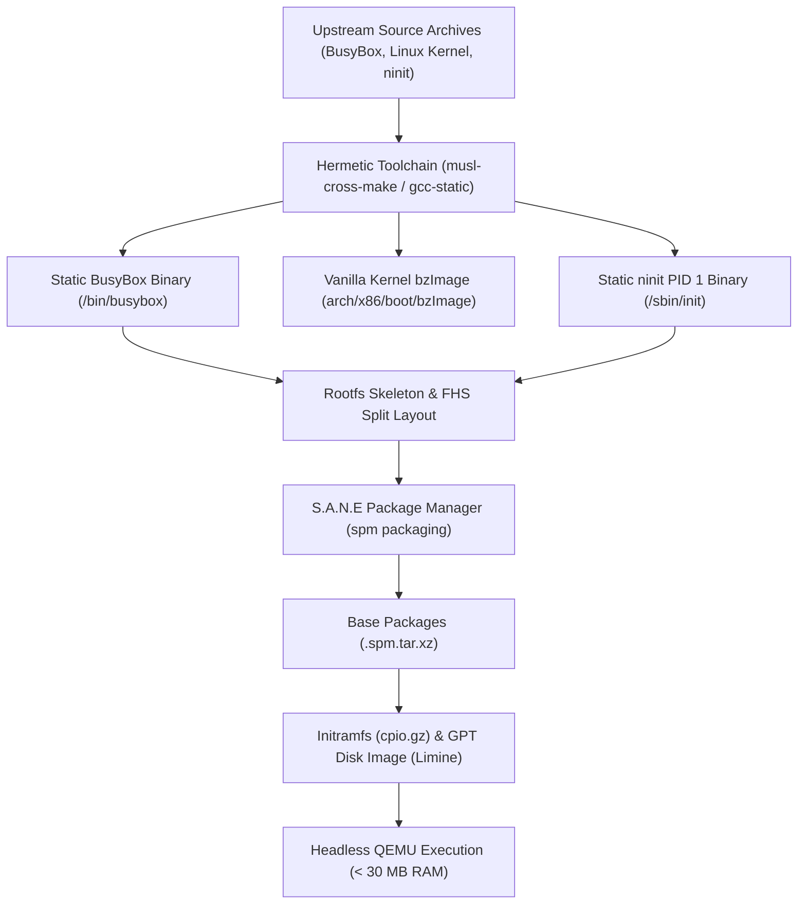

# Building S.A.N.E Linux from Source: Toolchain, Kernel, BusyBox, ninit & Rootfs Assembly

*[English](toolchain-and-rootfs-from-source.md)*

This engineering guide provides an exhaustive, step-by-step blueprint for compiling every component of S.A.N.E Linux purely from source code: from bootstrapping a hermetic static cross-toolchain and compiling BusyBox and the Linux kernel, to building `ninit` (PID 1), assembling the rootfs hierarchy, managing packages with `spm`, and validating the resulting system inside a headless QEMU virtual machine.

---

## Table of Contents
1. [Architecture Philosophy & Toolchain Strategy](#1-architecture-philosophy--toolchain-strategy)
2. [Bootstrapping a Hermetic Static Toolchain](#2-bootstrapping-a-hermetic-static-toolchain)
3. [Compiling BusyBox 1.36.1 from Upstream Source](#3-compiling-busybox-1361-from-upstream-source)
4. [Compiling Vanilla Linux Kernel (x86_64)](#4-compiling-vanilla-linux-kernel-x86_64)
5. [Compiling `ninit` (PID 1 Static Init Daemon)](#5-compiling-ninit-pid-1-static-init-daemon)
6. [Assembling the Rootfs Hierarchy from Source](#6-assembling-the-rootfs-hierarchy-from-source)
7. [Packaging Base Distro Components with `spm`](#7-packaging-base-distro-components-with-spm)
8. [Initramfs Bundling & Headless QEMU Verification](#8-initramfs-bundling--headless-qemu-verification)
9. [Automated End-to-End Build Pipeline](#9-automated-end-to-end-build-pipeline)

---

## 1. Architecture Philosophy & Toolchain Strategy

S.A.N.E Linux is engineered for high-security appliances and ultra-minimal deployments operating strictly within a **< 30 MB total RAM envelope**. To meet these constraints, the distribution eliminates traditional shared library dependencies:

- **Zero Dynamic Linker Overhead**: No `ld-linux.so` or `ld-musl.so` resides in the execution path. All binaries are 100% statically linked ELF executables.
- **Immunity to Version Drift**: Static linking eliminates runtime library mismatch, symbol conflicts, and shared library hijacking.
- **Fail-Closed Security**: Every binary has a single execution entry point with no runtime dynamic loading (`dlopen`).
- **Standard C Libraries**: S.A.N.E supports both static glibc (`gcc -static`) and musl libc (`musl-gcc` or `x86_64-linux-musl-gcc`). For maximum binary miniaturization, musl libc is the recommended target.



---

## 2. Bootstrapping a Hermetic Static Toolchain

A hermetic toolchain ensures that host system libraries do not contaminate the compiled guest binaries.

### Option A: Using `musl-cross-make` (Recommended for Clean Isolation)

`musl-cross-make` compiles a standalone, relocatable GCC toolchain targeting musl libc:

```bash
# 1. Install host prerequisites
sudo apt-get update && sudo apt-get install -y \
    build-essential curl git bison flex texinfo m4 libgmp-dev libmpfr-dev libmpc-dev

# 2. Clone musl-cross-make
git clone https://github.com/richfelker/musl-cross-make.git /tmp/musl-cross-make
cd /tmp/musl-cross-make

# 3. Configure the target architecture and versions
cat << 'EOF' > config.mak
TARGET = x86_64-linux-musl
OUTPUT = /opt/cross-musl
GCC_VER = 12.2.0
MUSL_VER = 1.2.4
BINUTILS_VER = 2.39
COMMON_CONFIG += CFLAGS="-g0 -Os" CXXFLAGS="-g0 -Os" LDFLAGS="-s"
GCC_CONFIG += --disable-nls --disable-libquadmath --disable-decimal-float
EOF

# 4. Build and install toolchain (takes ~5-10 minutes)
make -j"$(nproc)"
sudo make install

# 5. Export toolchain to environment
export PATH="/opt/cross-musl/bin:$PATH"
export CC="x86_64-linux-musl-gcc"
export CFLAGS="-static -O2 -fstack-protector-strong"
```

### Option B: Using System `musl-gcc` or Static Glibc

If a pre-packaged static compiler is sufficient on Ubuntu/Debian:

```bash
sudo apt-get install -y build-essential musl-tools busybox-static
export CC="gcc"
export CFLAGS="-static -O2 -Wall -fstack-protector-strong"
```

Verify that static linking works:
```bash
printf 'int main(void){return 0;}\n' | $CC $CFLAGS -xc - -o /tmp/test-static
readelf -l /tmp/test-static | grep -q INTERP && echo "FAIL: Dynamic" || echo "PASS: 100% Static"
rm -f /tmp/test-static
```

---

## 3. Compiling BusyBox 1.36.1 from Upstream Source

BusyBox provides the core UNIX applet suite (`/bin/sh`, coreutils, networking, and archive utilities) in a single static multi-call binary.

### 3.1 Downloading & Verifying Upstream Source

```bash
WORKDIR="/tmp/sane-build"
mkdir -p "$WORKDIR" && cd "$WORKDIR"

BB_VERSION="1.36.1"
BB_SHA256="b8cc24c9574d809e7279c3be349795c5d5ceb6fdf19ca709f80cde50e47de314"
BB_URL="https://busybox.net/downloads/busybox-${BB_VERSION}.tar.bz2"

curl -fL --retry 3 -o "busybox-${BB_VERSION}.tar.bz2" "$BB_URL"
echo "${BB_SHA256}  busybox-${BB_VERSION}.tar.bz2" | sha256sum -c -

tar -xjf "busybox-${BB_VERSION}.tar.bz2"
cd "busybox-${BB_VERSION}"
```

### 3.2 Configuring BusyBox for S.A.N.E

Generate the baseline configuration and customize key options:

```bash
# Generate full baseline config
make defconfig

# Helper function to modify .config options
set_config() {
    local opt="$1"
    local val="$2"
    sed -i -e "/^${opt}=y\$/d" -e "/^# ${opt} is not set\$/d" .config
    if [ "$val" = "y" ]; then
        echo "${opt}=y" >> .config
    else
        echo "# ${opt} is not set" >> .config
    fi
}

# 1. Enforce purely static binary build
set_config "CONFIG_STATIC" "y"

# 2. Disable TC applet (modern Linux headers removed CBQ definitions)
set_config "CONFIG_TC" "n"

# 3. Enable essential decompressors for package extraction (< 8 MB RAM decompression)
set_config "CONFIG_UNXZ" "y"
set_config "CONFIG_XZCAT" "y"
set_config "CONFIG_UNLZMA" "y"
set_config "CONFIG_GZIP" "y"
set_config "CONFIG_FEATURE_SEAMLESS_XZ" "y"
set_config "CONFIG_FEATURE_SEAMLESS_GZ" "y"

# 4. Enable cttyhack (essential for serial console shells)
set_config "CONFIG_CTTYHACK" "y"

# 5. Harmonize dependencies
make oldconfig
```

### 3.3 Compiling & Installing Applet Symlinks

```bash
# Compile with static flags
make LDFLAGS="-static" -j"$(nproc)"

# Verify static ELF binary
if readelf -l busybox 2>/dev/null | grep -E -q '(^|[[:space:]])INTERP([[:space:]]|$)|PT_INTERP'; then
    echo "ERROR: BusyBox is dynamically linked!" >&2
    exit 1
fi
echo "SUCCESS: BusyBox compiled as purely static ELF."

# Install into staging tree with applet symlinks
STAGING_BUSYBOX="$WORKDIR/staging-busybox"
mkdir -p "$STAGING_BUSYBOX"
make CONFIG_PREFIX="$STAGING_BUSYBOX" install
```

The resulting `$STAGING_BUSYBOX` contains `/bin/busybox` along with 400+ symlinks across `/bin`, `/sbin`, `/usr/bin`, and `/usr/sbin`.

---

## 4. Compiling Vanilla Linux Kernel (x86_64)

The Linux kernel boots the hardware/hypervisor, mounts the root filesystem, and launches `ninit` as PID 1.

### 4.1 Fetching Kernel Source

```bash
cd "$WORKDIR"
KERNEL_VERSION="6.6.134"
KERNEL_URL="https://cdn.kernel.org/pub/linux/kernel/v6.x/linux-${KERNEL_VERSION}.tar.xz"

curl -fL --retry 3 -o "linux-${KERNEL_VERSION}.tar.xz" "$KERNEL_URL"
tar -xf "linux-${KERNEL_VERSION}.tar.xz"
cd "linux-${KERNEL_VERSION}"
```

### 4.2 Appliance Kernel Configuration

Build a trimmed appliance configuration that strips unused physical drivers (Wi-Fi, sound, GPUs) while keeping virtio, ext4, devtmpfs, cgroups v2, and serial console active:

```bash
# Baseline x86_64 configuration
make x86_64_defconfig

# Helper script for kernel config manipulation
KCONFIG="./scripts/config"

# 1. Virtualization & Hypervisor Drivers (VirtIO)
$KCONFIG --enable CONFIG_VIRTIO
$KCONFIG --enable CONFIG_VIRTIO_PCI
$KCONFIG --enable CONFIG_VIRTIO_BLK
$KCONFIG --enable CONFIG_VIRTIO_NET
$KCONFIG --enable CONFIG_VIRTIO_CONSOLE

# 2. Filesystem Support (ext4 & pseudo filesystems)
$KCONFIG --enable CONFIG_EXT4_FS
$KCONFIG --enable CONFIG_EXT4_USE_FOR_EXT2
$KCONFIG --enable CONFIG_DEVTMPFS
$KCONFIG --enable CONFIG_DEVTMPFS_MOUNT
$KCONFIG --enable CONFIG_TMPFS
$KCONFIG --enable CONFIG_TMPFS_POSIX_ACL

# 3. Initramfs & Compression
$KCONFIG --enable CONFIG_BLK_DEV_INITRD
$KCONFIG --enable CONFIG_RD_GZIP
$KCONFIG --enable CONFIG_RD_XZ

# 4. Cgroups v2 Support (Required by ninit)
$KCONFIG --enable CONFIG_CGROUPS
$KCONFIG --enable CONFIG_CGROUP_FREEZER
$KCONFIG --enable CONFIG_CGROUP_PIDS
$KCONFIG --enable CONFIG_CGROUP_CPUACCT
$KCONFIG --enable CONFIG_MEMCG

# 5. Serial Console Output
$KCONFIG --enable CONFIG_SERIAL_8250
$KCONFIG --enable CONFIG_SERIAL_8250_CONSOLE

# 6. Disable Unneeded Subsystems for Speed and Size
$KCONFIG --disable CONFIG_SOUND
$KCONFIG --disable CONFIG_DRM
$KCONFIG --disable CONFIG_WIRELESS
$KCONFIG --disable CONFIG_WLAN
$KCONFIG --disable CONFIG_BLUETOOTH

# Resolve config dependencies
make olddefconfig
```

### 4.3 Building the Kernel `bzImage`

```bash
make -j"$(nproc)" bzImage

# Verify output
BZIMAGE="arch/x86/boot/bzImage"
[ -f "$BZIMAGE" ] || { echo "ERROR: bzImage not produced" >&2; exit 1; }
ls -lh "$BZIMAGE"
```

The resulting `bzImage` is typically `< 9 MB` in size.

---

## 5. Compiling `ninit` (PID 1 Static Init Daemon)

`ninit` is implemented in a single C file (`ninit.c`) with zero external library dependencies beyond standard libc.

### 5.1 Static Compilation

```bash
cd /home/ubuntu/workspace/sane-linux

# Compile with hardened static flags
gcc -static -O2 -Wall -Werror -fstack-protector-strong -o ninit ninit.c

# Verify static ELF properties
readelf -l ninit | grep -q INTERP && { echo "ERROR: ninit is dynamic" >&2; exit 1; }
strip --strip-all ninit
ls -lh ninit
```

### 5.2 Wrapper Utilities for IPC

In S.A.N.E Linux, user commands like `poweroff`, `reboot`, and `halt` communicate with `ninit` via `/run/initctl`:

```bash
mkdir -p "$WORKDIR/sbin-wrappers"

# Wrapper for poweroff
cat << 'EOF' > "$WORKDIR/sbin-wrappers/poweroff"
#!/bin/sh
if [ -p /run/initctl ]; then
    printf 'poweroff\n' > /run/initctl
else
    busybox poweroff -f
fi
EOF

# Wrapper for reboot
cat << 'EOF' > "$WORKDIR/sbin-wrappers/reboot"
#!/bin/sh
if [ -p /run/initctl ]; then
    printf 'reboot\n' > /run/initctl
else
    busybox reboot -f
fi
EOF

# Wrapper for halt
cat << 'EOF' > "$WORKDIR/sbin-wrappers/halt"
#!/bin/sh
if [ -p /run/initctl ]; then
    printf 'poweroff\n' > /run/initctl
else
    busybox halt -f
fi
EOF

chmod 0755 "$WORKDIR/sbin-wrappers"/*
```

---

## 6. Assembling the Rootfs Hierarchy from Source

With all binaries compiled, assemble the standard FHS split rootfs hierarchy:

```bash
ROOTFS="$WORKDIR/rootfs"
rm -rf "$ROOTFS"
mkdir -p "$ROOTFS"

# 1. Create standard directory layout
mkdir -p "$ROOTFS/bin" "$ROOTFS/sbin" "$ROOTFS/usr/bin" "$ROOTFS/usr/sbin"
mkdir -p "$ROOTFS/etc" "$ROOTFS/dev" "$ROOTFS/proc" "$ROOTFS/sys"
mkdir -p "$ROOTFS/run" "$ROOTFS/tmp" "$ROOTFS/var/log"
mkdir -p "$ROOTFS/var/lib/spm/installed" "$ROOTFS/var/lib/spm/rdeps" "$ROOTFS/var/lib/spm/staging"

# 2. Populate BusyBox applets
cp -a "$STAGING_BUSYBOX"/* "$ROOTFS/"

# 3. Install ninit as PID 1
install -m 0755 /home/ubuntu/workspace/sane-linux/ninit "$ROOTFS/sbin/init"

# 4. Install power management wrappers
cp -a "$WORKDIR/sbin-wrappers"/* "$ROOTFS/sbin/"

# 5. Populate /etc configurations
# Primary service table
cat << 'EOF' > "$ROOTFS/etc/init.conf"
console:respawn:cttyhack /bin/sh -i
EOF

# Hostname
echo "S.A.N.E" > "$ROOTFS/etc/hostname"

# Minimal credentials
cat << 'EOF' > "$ROOTFS/etc/passwd"
root:x:0:0:root:/root:/bin/sh
EOF

cat << 'EOF' > "$ROOTFS/etc/group"
root:x:0:
EOF

# Empty fstab placeholder
cat << 'EOF' > "$ROOTFS/etc/fstab"
# /etc/fstab: static filesystem information
# <file system> <mount point>   <type>  <options>       <dump>  <pass>
EOF

# 6. Create initial device nodes (requires root/fakeroot)
if [ "$(id -u)" -eq 0 ]; then
    mknod -m 600 "$ROOTFS/dev/console" c 5 1
    mknod -m 666 "$ROOTFS/dev/null" c 1 3
    mknod -m 666 "$ROOTFS/dev/tty" c 5 0
else
    echo "NOTICE: Non-root user; devtmpfs will populate device nodes automatically at boot."
fi
```

---

## 7. Packaging Base Distro Components with `spm`

To ensure full manageability by the S.A.N.E Package Manager (`spm`), components are packaged into `.spm.tar.xz` archives and registered in `/var/lib/spm`:

```bash
PACKAGES_OUT="$WORKDIR/distro-packages"
mkdir -p "$PACKAGES_OUT"

# 1. Build base packages using scripts/build-package.sh
/home/ubuntu/workspace/sane-linux/scripts/build-package.sh \
    --source /home/ubuntu/workspace/sane-linux/packages/busybox \
    --output "$PACKAGES_OUT" --base

/home/ubuntu/workspace/sane-linux/scripts/build-package.sh \
    --source /home/ubuntu/workspace/sane-linux/packages/ninit \
    --output "$PACKAGES_OUT" --base

/home/ubuntu/workspace/sane-linux/scripts/build-package.sh \
    --source /home/ubuntu/workspace/sane-linux/packages/sane-hello \
    --output "$PACKAGES_OUT"

# 2. Initialize database and register packages into the target rootfs
/home/ubuntu/workspace/sane-linux/scripts/spm init --root "$ROOTFS"

# 3. Install packages into target rootfs via spm
/home/ubuntu/workspace/sane-linux/scripts/spm install "$PACKAGES_OUT"/busybox-*.spm.tar.xz --root "$ROOTFS"
/home/ubuntu/workspace/sane-linux/scripts/spm install "$PACKAGES_OUT"/ninit-*.spm.tar.xz --root "$ROOTFS"
/home/ubuntu/workspace/sane-linux/scripts/spm install "$PACKAGES_OUT"/sane-hello-*.spm.tar.xz --root "$ROOTFS"

# 4. Verify installation
/home/ubuntu/workspace/sane-linux/scripts/spm list --root "$ROOTFS"
```

---

## 8. Initramfs Bundling & Headless QEMU Verification

Pack the completed rootfs into a compressed CPIO archive and boot it in headless QEMU.

### 8.1 Packing Initramfs

```bash
INITRAMFS="$WORKDIR/initramfs.cpio.gz"

(
    cd "$ROOTFS"
    find . -mindepth 1 | LC_ALL=C sort | cpio --null -ov --format=newc 2>/dev/null | gzip -9 > "$INITRAMFS"
)
ls -lh "$INITRAMFS"
```

### 8.2 Headless QEMU Boot & Verification

Boot the system in QEMU without an interactive display to verify boot milestones:

```bash
CONSOLE_LOG="$WORKDIR/qemu-console.log"

timeout 8s qemu-system-x86_64 \
    -m 256 \
    -no-reboot \
    -display none \
    -serial file:"$CONSOLE_LOG" \
    -kernel "$WORKDIR/linux-${KERNEL_VERSION}/arch/x86/boot/bzImage" \
    -initrd "$INITRAMFS" \
    -append "console=ttyS0 rdinit=/sbin/init panic=-1 quiet loglevel=7" || true

# Audit console milestones
echo "=== Boot Telemetry Audit ==="
grep "ninit start (PID 1)" "$CONSOLE_LOG" && echo "[PASS] PID 1 active"
grep "main loop ready" "$CONSOLE_LOG" && echo "[PASS] Event loop initialized"
grep "started console" "$CONSOLE_LOG" && echo "[PASS] Service console launched"
```

A clean boot produces:
```text
[2026-11-14 10:35:01] ninit: === ninit start (PID 1) v1.1.0 ===
[2026-11-14 10:35:01] ninit: hostname = S.A.N.E
[2026-11-14 10:35:01] ninit: started console (pid 402)
[2026-11-14 10:35:01] ninit: cgroup: 'console' (pid 402) -> /sys/fs/cgroup/ninit/console
[2026-11-14 10:35:01] ninit: main loop ready
```

---

## 9. Automated End-to-End Build Pipeline

For rapid reproduction, the entire process is automated via the repository Makefile targets:

```bash
# 1. Compile static ninit binary
make

# 2. Build base distro packages (.spm.tar.xz)
make packages

# 3. Build minimal rootfs & initramfs
make rootfs

# 4. Execute comprehensive tests
make test
make test-spm
make test-pkg

# 5. Boot interactive QEMU appliance
make qemu
```
